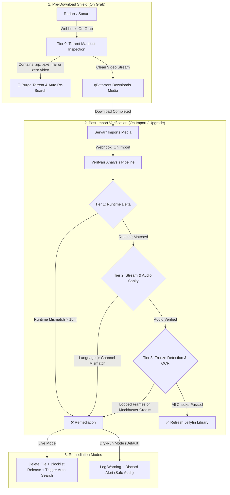
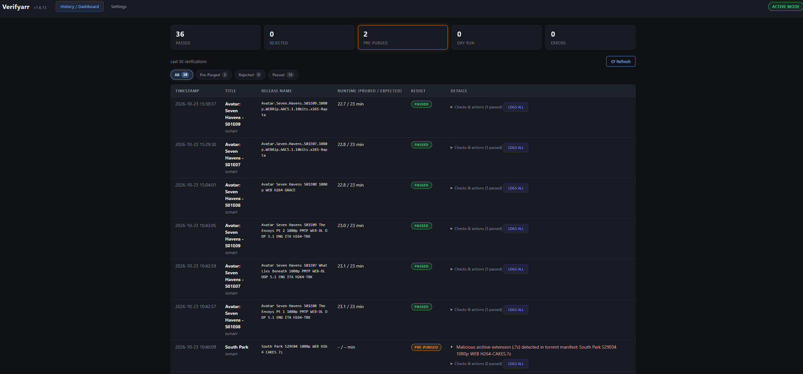
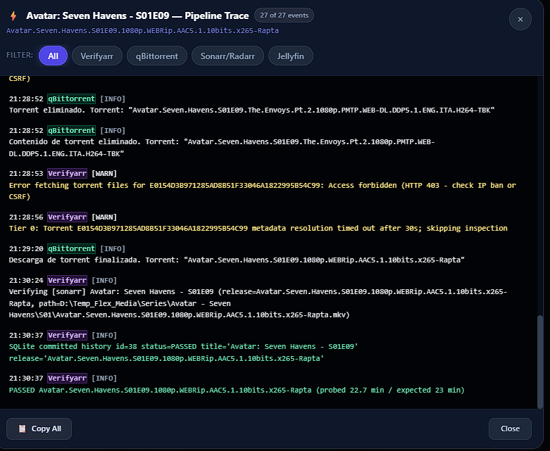
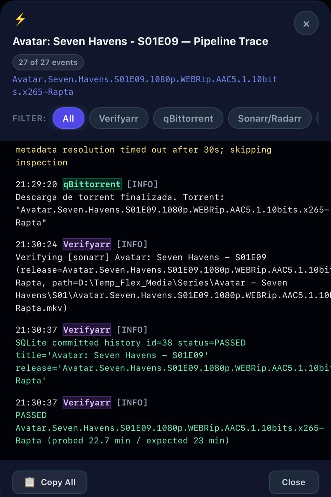
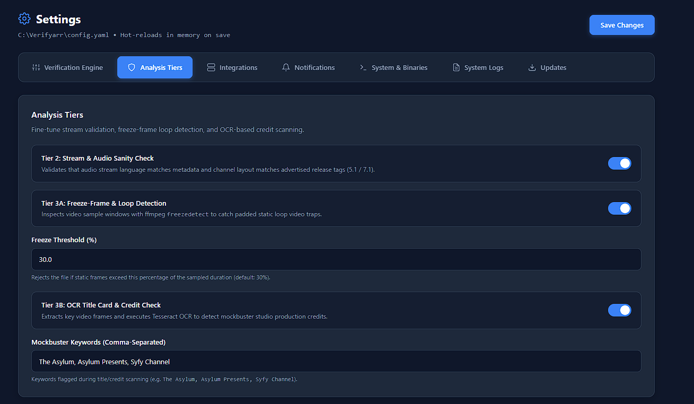
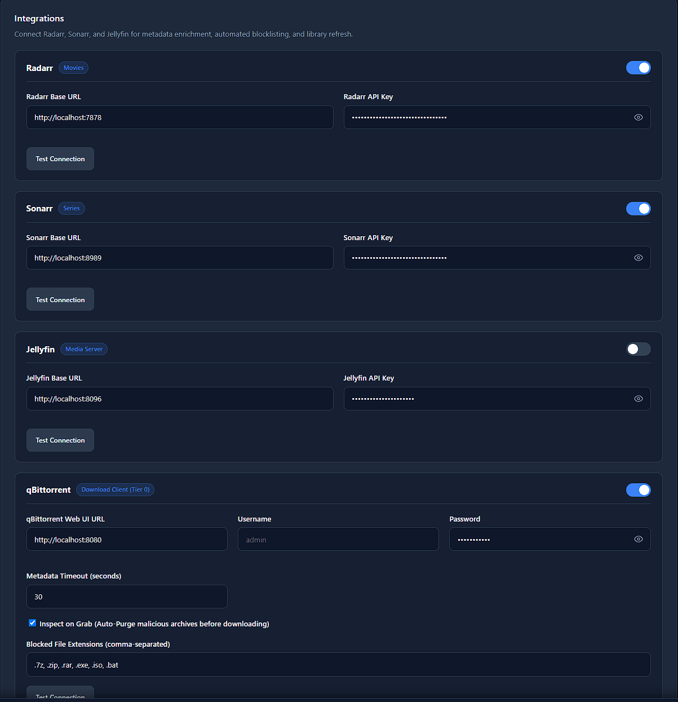

# Verifyarr

<p align="center">
  <strong>Automated Media Verification & Pre-Download Shield for Radarr, Sonarr, qBittorrent & Jellyfin</strong>
  <br />
  <em>Stop fake releases, corrupt video streams, and 80-minute mockbusters before they reach your media collection.</em>
</p>

<p align="center">
  <a href="https://github.com/camezaro-intc/Verifyarr/releases"></a>
  <a href="https://github.com/camezaro-intc/Verifyarr/pkgs/container/verifyarr"></a>
  <a href="https://github.com/camezaro-intc/Verifyarr/blob/main/LICENSE"></a>
  <a href="https://www.python.org/downloads/"></a>
</p>

---

## 💡 Why Verifyarr?

Radarr and Sonarr automate downloads based on **release titles and tracker metadata**, not the video inside the file. That leaves your home server open to common traps:

- 🎭 **Mockbuster Knock-offs**: Studios like *The Asylum* release low-budget titles mimicking blockbusters. An 86-minute B-movie gets imported in place of a 170-minute theatrical epic simply because the year and title collide.
- 📦 **Fake Releases & Malware**: Torrents packed with `.zip`, `.7z`, `.rar`, `.exe`, or `.iso` password traps rather than playable media.
- 🔄 **Loop & Freeze Scams**: Bogus uploads looping a 10-second trailer or frozen frame to fake the file size.
- 🔇 **Mismatched Audio**: Releases advertising 7.1 Atmos or original language tracks that only contain low-quality stereo or foreign dubs.

**Verifyarr acts as an automated bouncer with two defense layers:**
1. **Pre-Download Shield (On Grab)**: Inspects the torrent manifest in **qBittorrent** and purges archives and executable payloads *before wasting bandwidth or disk space*.
2. **Post-Import Deep Verification (On Import / Upgrade)**: Validates container runtime deltas, audio stream languages/channels, and video freeze patterns using `ffprobe`/`ffmpeg`.

---

## ⚡ How It Works



---

## ✨ Features at a Glance

| Feature | What It Does |
|---|---|
| 🛡️ **Tier 0 Pre-Download Shield** | Intercepts qBittorrent downloads upon grab. Automatically purges `.zip`, `.7z`, `.exe`, `.iso`, and zero-video releases. |
| ⏱️ **Runtime Delta Guard** | Compares `ffprobe` duration against TMDB/TVDB expected runtimes. Multi-episode files are automatically scaled. |
| 🔊 **Audio & Channel Sanity** | Confirms at least one audio stream matches original language, and verifies advertised Atmos / 7.1 releases aren't secretly stereo. |
| ❄️ **Freeze & Loop Detection** | Runs `ffmpeg freezedetect` on a 3-minute sample window to catch static frames and loop scams. |
| 🔍 **Correlated Pipeline Trace** | Multi-service diagnostic console correlating logs across **Verifyarr**, **qBittorrent**, **Servarr**, and **Jellyfin** with 1-click source filtering and iOS touch support. |
| 🔄 **1-Click Automated Updates** | Update the background service directly from the browser in ~2 seconds with zero downtime. |
| 📱 **Responsive Modern Dashboard** | Mobile-optimized interface with quick **Force Approve** whitelisting for director's cuts and extended editions. |
| 🧪 **Safe Dry-Run by Default** | Verifies and logs everything safely without deleting or blocklisting until you are ready to enable live remediation. |

---

## 📸 Screenshots

<p align="center">
  
</p>

<p align="center">
  <em>Real-time verification dashboard displaying recent inspections, runtime deltas, verification badges, and system status.</em>
</p>

<details>
<summary>🔍 <strong>View Pipeline Trace, Mobile UI & Settings Gallery</strong></summary>
<br />

### Correlated Multi-Service Pipeline Trace
<p align="center">
  
  <br />
  <em>Unified multi-app diagnostic console correlating timestamped events across Verifyarr, qBittorrent, Sonarr/Radarr, and Jellyfin.</em>
</p>

### Responsive Mobile Experience
<p align="center">
  
  <br />
  <em>Touch-optimized mobile card layout with instant Force Approve and one-tap Pipeline Trace inspection.</em>
</p>

### Analysis Tiers & Integrations Management
<p align="center">
  
  <br />
  <em>Granular verification thresholds, audio sanity toggles, and OCR mockbuster keyword rules.</em>
</p>
<p align="center">
  
  <br />
  <em>Arr-style connection management with 1-click credential validation for Radarr, Sonarr, Jellyfin, and qBittorrent.</em>
</p>

</details>

---

## 🚀 Quick Start

### 1. Windows (1-Click Installer) — *Recommended*

1. Download **`Verifyarr-windows-x64-Setup.exe`** from [Latest Releases](https://github.com/camezaro-intc/Verifyarr/releases/latest).
2. Run the installer (Administrator). It sets up `C:\Verifyarr`, configures the background Windows service, and launches the app.
3. Open **`http://localhost:7979`** in your browser.

*(Portable `.zip` with `install-service.bat` and `run-standalone.bat` is also available).*

### 2. Docker Compose

```yaml
services:
  verifyarr:
    image: ghcr.io/camezaro-intc/verifyarr:latest
    container_name: verifyarr
    restart: unless-stopped
    user: "1000:1000"
    ports:
      - "7979:7979"
    volumes:
      - ./config.yaml:/app/config.yaml
      - ./data:/app/data
      - /path/to/media:/media:ro
    extra_hosts:
      - "host.docker.internal:host-gateway"
```

Start the container:
```bash
docker compose up -d
```

### 3. Linux Portable (systemd)

1. Download **`Verifyarr-linux-x64.tar.gz`** from [Latest Releases](https://github.com/camezaro-intc/Verifyarr/releases/latest).
2. Extract and enable the systemd service:
   ```bash
   sudo tar -xzvf Verifyarr-linux-x64.tar.gz -C /opt/
   sudo cp /opt/verifyarr/scripts/systemd/verifyarr.service /etc/systemd/system/
   sudo systemctl daemon-reload && sudo systemctl enable --now verifyarr
   ```

---

## 🔗 Connect Radarr & Sonarr (3 Steps)

1. In Radarr and Sonarr, go to **Settings** > **Connect** > click **+ (Add Connection)** > **Webhook**.
2. Configure the webhook:
   - **Name**: `Verifyarr`
   - **Triggers**: Tick **On Download** / **On File Import**, **On Upgrade**, and **On Grab** (for Tier 0 pre-download inspection).
   - **URL**: `http://localhost:7979/api/v1/webhook` *(or `http://verifyarr:7979/api/v1/webhook` in Docker)*
   - **Method**: `POST`
3. Click **Test** and **Save**. Your library is now guarded!

---

<details>
<summary>⚙️ <strong>Configuration Reference (config.yaml)</strong></summary>

Verifyarr can be configured through the web interface at `http://localhost:7979/settings` or by editing `config.yaml`. Environment variables use the `VERIFYARR_` prefix (e.g. `VERIFYARR_RADARR__API_KEY=...`).

### `server`
| Key | Default | Description |
|-----|---------|-------------|
| `server.host` | `"0.0.0.0"` | Interface to listen on. |
| `server.port` | `7979` | HTTP port for webhook, dashboard, and settings UI. |
| `server.log_level` | `"info"` | Logging level: `info`, `debug`, `warning`, `error`. |

### `verification`
| Key | Default | Description |
|-----|---------|-------------|
| `verification.dry_run` | `true` | Safe audit mode. Set to `false` to enable automatic deletion and blocklisting. |
| `verification.max_concurrent_probes` | `2` | Maximum concurrent ffmpeg/ffprobe tasks to prevent disk I/O saturation. |
| `verification.runtime_delta_threshold_minutes` | `15` | Maximum allowable difference between probed and expected duration (minutes). |
| `verification.enable_audio_sanity_check` | `true` | Validates audio stream language and channel layout against advertised metadata. |
| `verification.enable_freeze_detection` | `true` | Scans sample window for frozen or loop frame traps using ffmpeg. |
| `verification.freeze_threshold_percent` | `30` | Maximum allowable frozen percentage in sample window. |
| `verification.enable_ocr_credit_check` | `false` | Uses Tesseract OCR to scan credits for mockbuster studio keywords. |
| `verification.mockbuster_keywords` | `["The Asylum", "Asylum Presents", "Syfy Channel"]` | Keywords flagged during OCR scanning. |

### `qbittorrent`
| Key | Default | Description |
|-----|---------|-------------|
| `qbittorrent.enabled` | `false` | Enable Tier 0 pre-download torrent inspection. |
| `qbittorrent.url` | `"http://localhost:8080"` | Base URL of qBittorrent Web UI. |
| `qbittorrent.username` | `"admin"` | Web API username. |
| `qbittorrent.password` | `""` | Web API password. |
| `qbittorrent.inspect_on_grab` | `true` | Intercept Servarr **On Grab** webhooks to verify torrent file manifests. |
| `qbittorrent.metadata_timeout_seconds` | `30` | Timeout waiting for torrent metadata resolution from peers. |
| `qbittorrent.blocked_extensions` | `[".7z", ".zip", ".rar", ".exe", ".iso", ".bat"]` | Blacklisted extensions triggering immediate purge and Servarr blocklisting. |

### `radarr`, `sonarr`, `jellyfin`
| Key | Default | Description |
|-----|---------|-------------|
| `radarr.enabled` | `true` | Process Radarr webhooks and enable automatic remediation. |
| `radarr.url` | `"http://localhost:7878"` | Base URL of Radarr. |
| `radarr.api_key` | `""` | Radarr API key. |
| `sonarr.enabled` | `false` | Process Sonarr webhooks and enable automatic remediation. |
| `sonarr.url` | `"http://localhost:8989"` | Base URL of Sonarr. |
| `sonarr.api_key` | `""` | Sonarr API key. |
| `jellyfin.enabled` | `false` | Trigger a debounced library refresh when verifications pass. |
| `jellyfin.url` | `"http://localhost:8096"` | Base URL of Jellyfin. |
| `jellyfin.api_key` | `""` | Jellyfin API token. |

</details>

<details>
<summary>📡 <strong>REST API Endpoints</strong></summary>

| Method | Endpoint | Description |
|---|---|---|
| `GET` | `/` | Responsive Web Dashboard |
| `GET` | `/settings` | Settings Management Interface |
| `POST` | `/api/v1/webhook` | Ingest Radarr/Sonarr Webhooks |
| `POST` | `/api/v1/whitelist/{item_id}` | Force-approve a false positive and refresh Jellyfin |
| `GET` | `/api/v1/history/{item_id}/correlated-logs` | Fetch correlated multi-service trace logs |
| `GET` | `/api/v1/system/version` | Lightweight local version probe |
| `GET` | `/api/v1/system/update/check` | Check GitHub for new releases |
| `POST` | `/api/v1/system/update/apply` | Stage and trigger 1-click self-update |
| `GET` | `/health` | Health and operational mode status probe |

</details>

<details>
<summary>🛠️ <strong>Development & Running from Source</strong></summary>

```powershell
git clone https://github.com/camezaro-intc/Verifyarr.git
cd Verifyarr
python -m venv .venv
.\.venv\Scripts\activate
pip install -r requirements.txt
python -m src.main
```

Run tests and type checks:
```powershell
pytest
ruff check .
mypy src
```

</details>

---

## 📄 License & Contributing

- Distributed under the [MIT License](LICENSE).
- Bug reports, feature suggestions, and pull requests are warmly welcomed! See [CONTRIBUTING.md](CONTRIBUTING.md).
